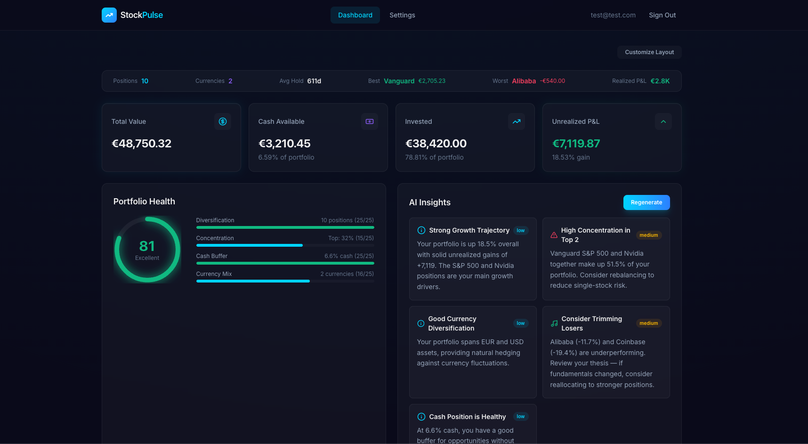
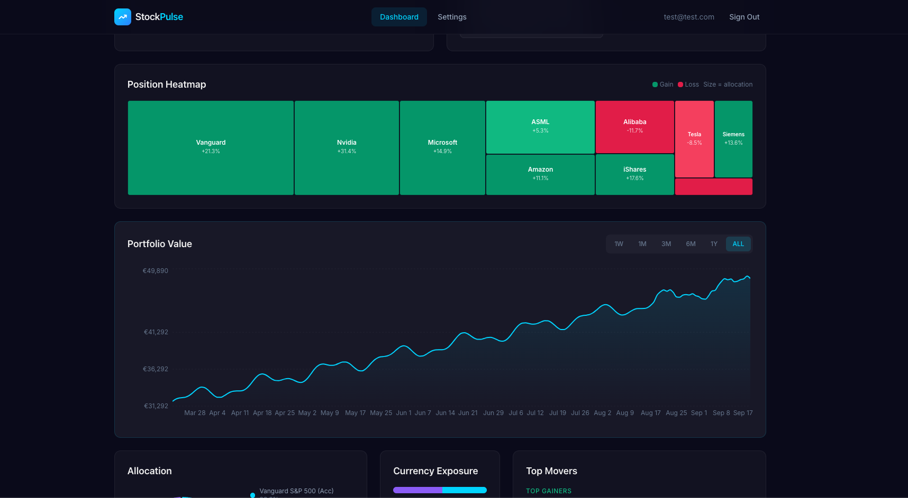
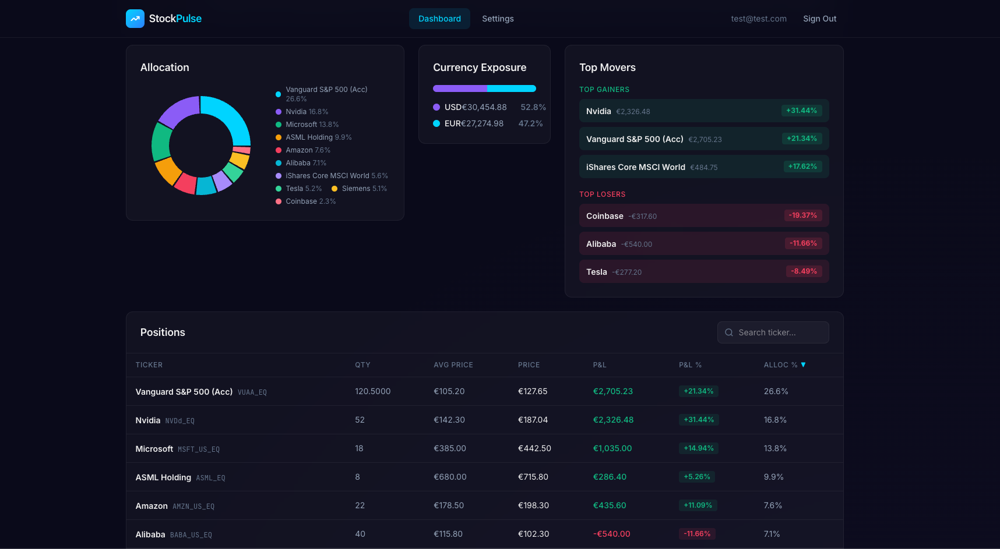
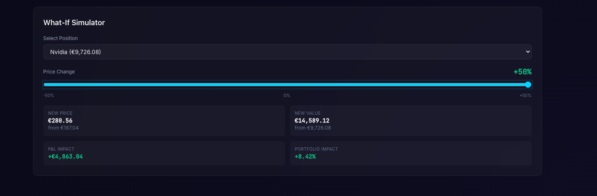

# StockPulse

A self-hosted, AI-powered portfolio tracker for [Trading 212](https://www.trading212.com). Connect your account, track performance over time, and get AI-generated insights about your portfolio.

> **Disclaimer:** This project is not affiliated with, endorsed by, or connected to Trading 212 UK Ltd.

> **Note:** All screenshots below use demo data with fictional portfolio values for illustration purposes.



## Features

**Portfolio Dashboard**

- Real-time portfolio summary (total value, cash, invested, unrealized P&L)
- Stats ribbon with key metrics at a glance
- Portfolio health score with diversification, concentration, and cash analysis
- Drag-and-drop customizable layout — reorder sections however you want

**Visualizations**

- Position heatmap — treemap colored by P&L, sized by allocation
- Historical portfolio value chart with time range selector (1W to ALL)
- Allocation donut chart, currency exposure breakdown, top movers





**Portfolio-Wide Market Data**

- Analyst sentiment across every covered holding, weighted by position size, so
  a 30% position counts for more than a 2% one
- Earnings for each holding, reported against estimates
- A news feed spanning your holdings, rotated one headline per company so the
  most-covered name cannot fill it
- Coverage is stated plainly — "4 of 7 covered" — rather than quietly omitting
  what could not be matched

**Per-Stock Analysis**

Click any holding for its own page. Everything from the market-data provider is
free and loads as soon as the page opens; only the written analysis costs
anything.

- **Analyst consensus** — buy/hold/sell counts from Finnhub with the source and
  fetch time, plus how the ratings moved over recent months
- **Fundamentals** — P/E, P/B, beta, dividend yield, margins, return on equity,
  market cap, and where the price sits in its 52-week range
- **Earnings** — reported EPS against estimates for recent quarters
- **Recent news** and **peer companies**
- **AI analysis** — a reading of all of the above against _your_ position: cost
  basis, size and share of the portfolio. Rendered on its own surface, labelled
  with the model that wrote it, and explicitly not advice

Holdings are matched by **ISIN rather than ticker**, because a Trading 212
ticker is not always the market-data symbol — `CAPA_US_EQ` is Quantum-Si, which
Finnhub knows as `QSI`. For European listings the venue-suffixed symbol is
premium-gated, so the unsuffixed one is used, but only when its registered
company name matches the one the ISIN resolved to. A base-symbol collision
therefore cannot attach another company's ratings to a holding.

Funds and ETFs generally have no analyst coverage. When nothing can be matched,
no figures are shown rather than guessed ones.

**What-If Simulator**

- Select any position, drag the price change slider (-50% to +50%)
- Instantly see the impact on position value and total portfolio



**AI Insights**

- Connects to [LLM Gateway](https://github.com/NourAldeenKassar/llm-gateway) for AI-powered portfolio analysis
- Generates actionable insights: concentration warnings, diversification suggestions, P&L observations
- Insights are saved to DB — loads instantly on next visit, regenerate on demand
- **Two tiers, selected by which key is used.** Whole-portfolio insights use
  the standard gateway key; per-stock analysis uses the separate "smarter
  model" key, so point that one at a key issued on your gateway's paid tier.
  Keeping them separate means the paid spend is tracked and revocable on its
  own. Results are cached per holding, so reopening a stock does not re-bill
- Configured per-user in Settings, not as a server requirement

**Data Collection**

- Configurable snapshot frequency per account (hourly to daily)
- Automatic cron job stores portfolio snapshots for historical charts
- Encrypted API credential storage (AES-256-GCM)

**Multi-User**

- Email + password authentication with JWT
- Each user connects their own Trading 212 API key
- Users only see their own data

## Tech Stack

| Layer       | Technology                                                 |
| ----------- | ---------------------------------------------------------- |
| Backend     | NestJS 12, TypeScript 6                                    |
| Database    | PostgreSQL, Prisma 7 (pg driver adapter)                   |
| Frontend    | Next.js 16, React 19, Tailwind CSS 4                       |
| Charts      | Recharts 3 (area, pie, treemap)                            |
| Drag & Drop | dnd-kit                                                    |
| Auth        | JWT (access + refresh tokens), bcrypt                      |
| Encryption  | AES-256-GCM (Node.js crypto)                               |
| Market data | Finnhub (free tier)                                        |
| Scheduling  | @nestjs/schedule (cron)                                    |
| Hardening   | helmet, CORS allow-list, request validation, rate limiting |
| Deployment  | Docker, Nginx reverse proxy                                |

TypeScript is held at 6 deliberately: 7.0 ships without the programmatic
compiler API that the Nest CLI and `typescript-eslint` both depend on.

## Quick Start

### Prerequisites

- Node.js 22+
- PostgreSQL 16+
- A [Trading 212](https://www.trading212.com) Invest account with API access
- Optional: a [Finnhub](https://finnhub.io) key and an
  [LLM Gateway](https://github.com/NourAldeenKassar/llm-gateway) for market data
  and AI analysis. The tracker works without either.

### Setup

```bash
git clone https://github.com/NourAldeenKassar/stockpulse.git
cd stockpulse

# Install dependencies
npm install
cd frontend && npm install && cd ..

# Configure environment
cp .env.example .env
# Set DATABASE_URL, and generate the secrets:
#   openssl rand -hex 32   (for each JWT secret, they must differ)
#   openssl rand -hex 32   (for ENCRYPTION_KEY, exactly 64 hex chars)

# Create the schema
npx prisma migrate deploy

# Start development
npm run dev
```

Open `http://localhost:3001` and create an account. In **Settings**, connect
your Trading 212 API key, and optionally add a Finnhub key and LLM Gateway to
turn on market data and AI analysis.

The API runs on `3000` and the frontend on `3001`. If either port is taken, set
`PORT` in `.env` and `FRONTEND_ORIGIN` to match, or the browser will be blocked
by CORS.

### Docker

```bash
docker compose up -d
```

This starts PostgreSQL and the app behind Nginx on port `3000`, with the API
under `/api`. Migrations run automatically on container start.

## Environment Variables

| Variable              | Required | Description                                                                           |
| --------------------- | -------- | ------------------------------------------------------------------------------------- |
| `DATABASE_URL`        | Yes      | PostgreSQL connection string                                                          |
| `JWT_SECRET`          | Yes      | Secret for access token signing                                                       |
| `JWT_REFRESH_SECRET`  | Yes      | Secret for refresh token signing                                                      |
| `ENCRYPTION_KEY`      | Yes      | 64-char hex string for AES-256 encryption                                             |
| `TRADING212_BASE_URL` | No       | Defaults to `https://live.trading212.com`                                             |
| `PORT`                | No       | API port, defaults to `3000`                                                          |
| `FRONTEND_ORIGIN`     | No       | Allowed CORS origin, defaults to `http://localhost:3001`. Comma-separate for several. |

Secrets must be at least 32 characters and the two JWT secrets must differ;
the API refuses to start otherwise. `ENCRYPTION_KEY` must be exactly 64 hex
characters.

Provider credentials are not environment variables — see below.

## Configuring Providers

All three are optional and configured per user in **Settings → Connections**,
never in environment variables. Each is encrypted with AES-256-GCM before
storage, and only the last four characters are ever sent back to the browser.

| Provider          | Enables                                              | Without it                                                              |
| ----------------- | ---------------------------------------------------- | ----------------------------------------------------------------------- |
| **LLM Gateway**   | Portfolio insights, on free providers                | No AI insights                                                          |
| **Smarter model** | Per-stock analysis, on paid providers                | Falls back to the gateway above                                         |
| **Finnhub**       | Analyst ratings, fundamentals, earnings, news, peers | Analysis runs on your position data alone, with no market figures shown |

The Settings page states the status of each — set, incomplete, or not set — so
a URL saved without its key reads as incomplete rather than looking ready.

[Finnhub](https://finnhub.io) has a free tier that covers everything used here.
Its limit is 60 calls a minute; responses are cached and concurrent requests
for the same data are collapsed into one, so normal use stays well inside it.

## Development

```bash
npm run dev          # API and frontend together
npm test             # backend unit tests
npm run lint         # eslint + prettier
npm run build        # compile the API
```

Do not run `npm run build` while `npm run dev` is running: both write to
`dist/` and the API will exit with `MODULE_NOT_FOUND`.

CI builds and lints both projects and runs the test suite. The frontend type
checks against the backend's Trading 212 types, so a change to those can break
the frontend build — which is why CI builds it rather than leaving that to the
Docker image.

## Project Structure

```
stockpulse/
  src/
    auth/           # JWT authentication + guards
    account/        # Trading 212 account management
    trading212/     # API client, rate limiting, typed errors
    marketdata/     # Finnhub client, ISIN to symbol resolution
    snapshot/       # Scheduled portfolio snapshots
    insight/        # Portfolio insights, per-stock analysis, market overview
    llm/            # LLM Gateway client (free and paid tiers)
    user/           # Per-user encrypted provider credentials
    crypto/         # AES-256-GCM encryption service
    common/         # Rate limiter and TTL cache
    prisma/         # Database module
  frontend/
    app/            # Next.js pages (dashboard, stock detail, settings, auth)
    components/
      ui/           # Card, Button, Badge, Spinner, Skeleton primitives
    lib/            # API client, hooks, type scale, colour palette
  prisma/
    schema.prisma   # Database schema
```

## License

MIT
